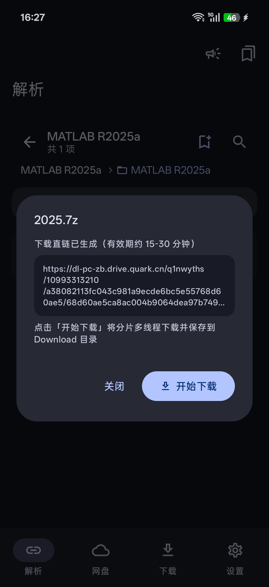
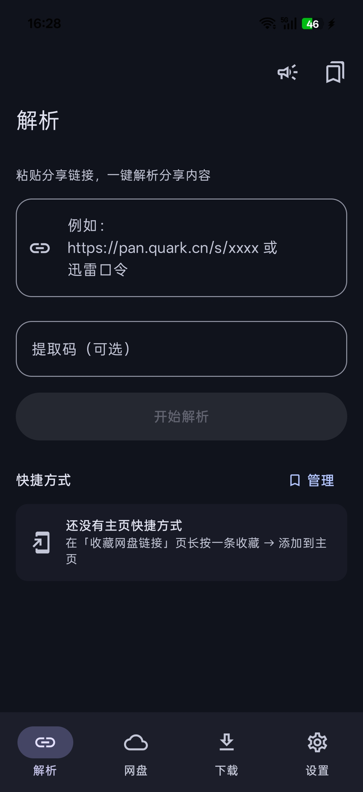
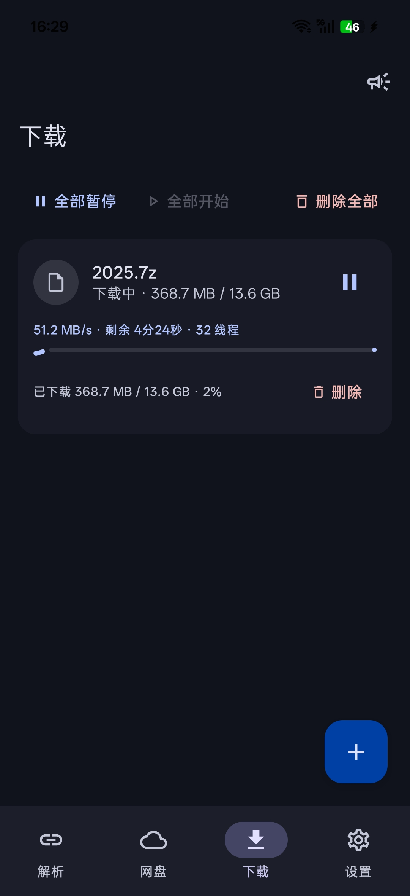
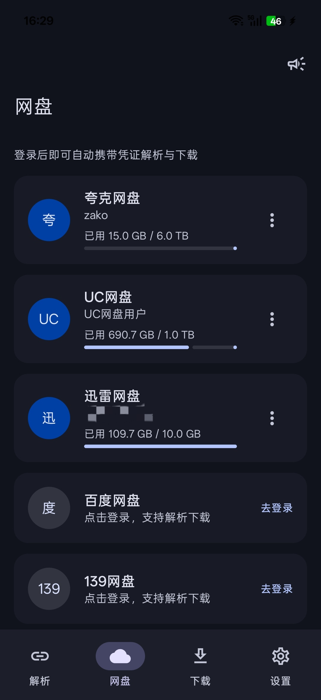
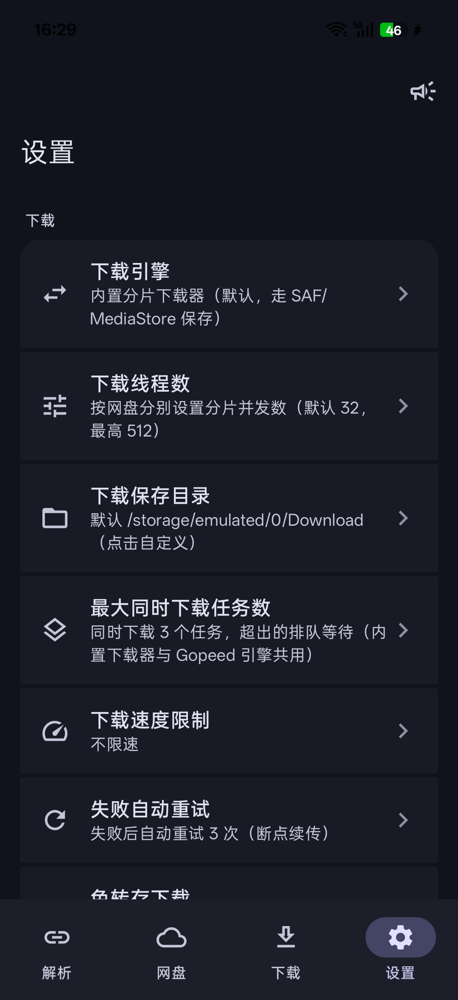
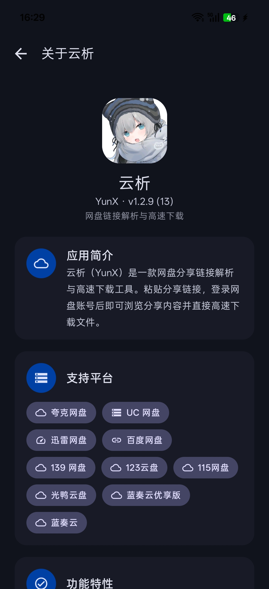

# 杂鱼Max · Zayu

**粘贴分享链接，直接高速下载 —— 一个开源的 Android 网盘解析下载应用**

识别夸克 / UC / 迅雷 / 百度 / 139 / 123 / 115 / 光鸭 / 蓝奏云 / 蓝奏云优享版 / 小飞机 / 城通 / PikPak / 联通云盘 / 天翼云盘 分享链接，自动匹配提取码，Range 分片并发 + 断点续传。

[功能](#功能) · [支持平台](#支持平台) · [使用](#使用) · [构建](#构建) · [常见问题](#常见问题)

***

> **杂鱼永远免费开源。** 如果你是在任何地方"花钱买到"的，说明你被骗了，请立即退款。
> 任何收费版本均为二次打包的诈骗版本，与本项目无关。

> **杂鱼使用 AGPL-3.0 开源协议。** 如果你使用了杂鱼的代码，请遵守协议，同样以 AGPL-3.0 开放源代码。

> **杂鱼是独立项目。** 本仓库不隶属于任何其他网盘解析项目，也不作为任何项目的下游或分支存在。
> 界面、架构与平台适配均由本仓库自行维护。

> 本仓库为 Android 端；桌面端（Windows）见 [Zayu-Desktop](https://github.com/tidain/YunX-Desktop)

## 截图

|                      |                        |                         |
| :-----------------------: | :-------------------------: | :--------------------------: |
|   |  |  |
|            解析直链           |             分享解析            |             下载管理             |
|  |    |       |
|            网盘登录           |              设置             |              关于              |

## 功能

- **分享链接解析** —— 识别 15 家网盘的分享链接，自动匹配提取码；链接里、剪贴板里、分享文案里夹带的提取码都能抽出来

- **高速下载** —— Range 分片并发 + 断点续传，任务保存请求头与固定分片规划，并发上限 32

- **游客模式** —— 免登录的平台（小飞机、城通）全程匿名可用；联通 / 天翼 / PikPak 游客可先浏览分享内容，取直链时再提示登录

- **临时转存清理** —— 百度 / 迅雷 / 光鸭 / PikPak 取链后清理；夸克保留到下载完成或删除任务后清理

- **多平台登录** —— 夸克 / UC / 百度 / 139 / 115 使用 WebView Cookie；迅雷 / 光鸭 使用账号密码 / 短信验证码；123 使用账号密码换取 JWT；蓝奏云 / 蓝奏云优享版 使用账号密码；PikPak 使用 access_token / refresh_token；联通云盘、天翼云盘使用 Cookie 或 token

- **凭证加密** —— 账号凭证经 Android Keystore 加密后落盘，不明文存储

- **认证备份** —— 使用用户口令派生密钥，以 AES-GCM 加密 Cookie / JWT 备份文件

- **剪贴板识别** —— 复制分享链接后回到应用，提示一键粘贴解析

- **液态玻璃界面** —— RenderEffect 背景模糊 + AGSL 边缘折射 / 色散，尺寸自适应

## 支持平台

| 平台             | 分享解析 | 游客可用 | 登录方式                        |
| -------------- | :--: | :--: | --------------------------- |
| 夸克网盘           |   ✓  |  —   | WebView Cookie              |
| UC 网盘          |   ✓  |  —   | WebView Cookie              |
| 迅雷网盘           |   ✓  |  —   | 账号密码 / 短信验证码                |
| 百度网盘           |   ✓  |  —   | WebView Cookie              |
| 123 云盘         |   ✓  |  —   | 账号密码换 JWT                   |
| 139 网盘（和彩云）    |   ✓  |  —   | WebView Cookie              |
| 115 网盘         |   ✓  |  —   | WebView Cookie              |
| 光鸭云盘           |   ✓  |  —   | 账号密码 / 短信验证码                |
| 蓝奏云            |   ✓  |  —   | 账号密码                        |
| 蓝奏云优享版         |   ✓  |  —   | 账号密码                        |
| 小飞机网盘（feijipan） |   ✓  |   ✓  | 免登录                         |
| 城通网盘（ctfile）    |   ✓  |   ✓  | 免登录                         |
| PikPak         |   ✓  |  浏览 | access\_token / refresh\_token |
| 联通云盘（wopan）    |   ✓  |  浏览 | Cookie / token              |
| 天翼云盘（189）      |   ✓  |  浏览 | Cookie                      |

> \[!WARNING]
> **不建议使用百度网盘，可能导致账号被风控！**

> \[!NOTE]
> 其他网盘暂未支持，如有需要欢迎到 QQ 交流群（群号 436393968）反馈。

## 使用

1. 在「网盘」页登录需要使用的网盘账号（免登录平台可跳过）
2. 在「解析」页粘贴分享链接（可带提取码）
3. 浏览分享内容，点击文件获取下载直链
4. 在「下载」页查看进度，支持暂停 / 继续 / 删除 / 打开

## 技术栈

| 分类  | 选型                                     |
| --- | -------------------------------------- |
| 语言  | Kotlin                                 |
| UI  | Jetpack Compose + Material 3 Expressive |
| 持久化 | Room（KSP 注解处理）+ SharedPreferences      |
| 网络  | OkHttp 4.12.0（请求 + 分片下载）               |
| 构建  | Gradle + KSP                           |

## 构建

要求：minSdk 24，targetSdk 34。

用 Android Studio 打开项目直接构建即可。项目在 AndroidIDE 上开发调试，理论上也兼容其它 Android 构建环境。

仓库自带 `debug.keystore`，无需配置签名即可 `assembleDebug` 出包；要打 release 包时把自己的 `keystore.properties` 放到仓库根目录或上级目录即可。

## 常见问题

<b>百度网盘下载/转存不了？</b>

你的账号被风控了。

<b>有没有 PC 端？</b>

有，见 [Zayu-Desktop](https://github.com/tidain/YunX-Desktop)（Windows）。

<b>PikPak / 联通 / 天翼为什么显示未登录？</b>

这三家需要 token 或 Cookie 才能取直链。点卡片进登录弹窗填入凭证即可；未登录时仍可浏览分享内容里的文件列表。

## 致谢

- [文析助手](https://github.com/z7786/wenxi)（提供了部分接口）
- [Backdrop / AndroidLiquidGlass](https://github.com/Kyant0/AndroidLiquidGlass)（液态玻璃绘制原语，Apache-2.0）

## 反倒卖

> 杂鱼完全免费开源。如果你下载到要钱的版本，那么你就是被骗了，请立马去退款。

- 倒卖狗 🐶：`qq1360735243`

## 免责声明

本项目仅供个人学习与技术交流，请勿用于商业用途。下载内容版权归原作者所有，请在下载后 24 小时内删除。使用本项目产生的任何后果由使用者自行承担。

## 开源协议

本项目基于 [GNU AGPL-3.0](https://www.gnu.org/licenses/agpl-3.0.html) 协议开源，详见根目录 [LICENSE](./LICENSE)。第三方组件的版权与许可声明见 [NOTICE](./NOTICE)。
